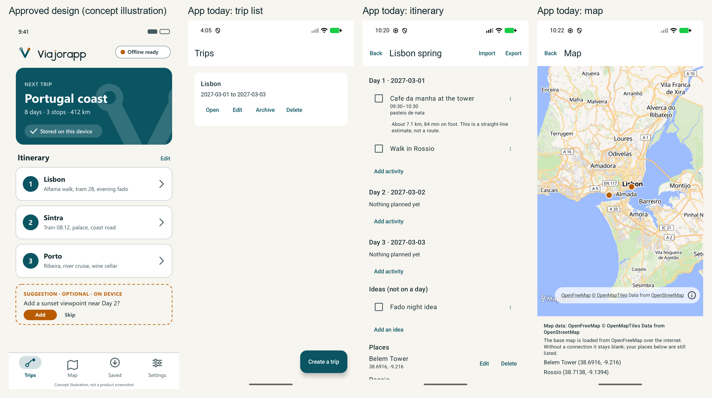

# UX and UI review: the app against the chosen Waypoint design

Date: 2026-11-02. Reviewer: the maintainers' agent, from emulator screenshots and the code. This is a
heuristic review, not a usability test with people.

## Verdict

**The owner is right.** The app works, but it does not look like the design that was approved. It is a
nearly default Material 3 app with the Waypoint colours applied. Of what makes the concept recognisable
(the V mark and wordmark, the type, the hero card, the numbered itinerary cards, the bottom navigation, the
icons, the accent), only the colour palette and the launcher icon reached the app. **No Viajorapp logo,
wordmark or banner appears on any screen**, and there is not a single drawable resource in the UI module.

Why it happened: the screens were built for function first and the brand work stopped at tokens and the
launcher icon. The concept's mock screen was never used as a layout specification, and fonts, icons and the
logo were left as follow-ups that were never scheduled. That was a planning failure, not a design choice.

## Scores (reviewer's judgement, 1 = absent, 5 = matches the concept)

| Area | Score | Why |
| --- | --- | --- |
| Brand presence (logo, wordmark, banner, splash) | 1 | Launcher icon only |
| Layout fidelity to the concept | 2 | Different structure: no hero, no cards, no bottom navigation |
| Colour | 4 | Tokens match; the accent is used almost nowhere |
| Typography | 1 | Manrope and Inter are not bundled; the system font and Material defaults are used |
| Iconography | 1 | No icons at all; a text "⋮" and text buttons instead |
| Visual hierarchy | 2 | Plain headings and many equal-weight text buttons |
| Usability of the flows | 3 | Flows work and are honest; navigation and actions are hard to scan |
| Accessibility basics | 3 | Contrast tokens pass; labels exist; not tested with a screen reader or large text |

## Gaps against the concept screen

Priority: **P1** breaks the brand promise or hurts everyday use, **P2** clearly visible gap, **P3** polish.

| Element in the concept | What the app does today | Priority |
| --- | --- | --- |
| Header with the V symbol and "Viajorapp" wordmark | Plain text "Trips" in a white bar; no logo anywhere | P1 |
| Splash and empty state with the brand | Default system splash; empty state is text and a button | P1 |
| Hero card "Next trip" (teal, V watermark, days and stops, "Stored on this device") | Not present; the trip list is one flat white card per trip | P1 |
| Numbered, tappable itinerary cards with a chevron | Day headings with a list of rows and four equal text buttons (Open, Edit, Archive, Delete) per trip | P1 |
| Bottom navigation (Trips, Map, Saved, Settings) | Top-bar text buttons (Search, Settings); Map hidden at the bottom of an itinerary; no way to reach it from the list | P1 |
| Manrope for headings, Inter for text | System font | P2 |
| Line icons (route, map, download, sliders) | None; text-only buttons | P2 |
| Accent colour on the destination dot, suggestions and badges | Orange appears only on map markers | P2 |
| Status chip "Offline ready" | Absent (see the honesty note below) | P2 |
| Optional suggestion block (dashed, accent) | Absent: the optional AI assistant is not built | P3 |
| Rounded surfaces, outlined cards, generous spacing | Material defaults; cards are flat; spacing is tight on the itinerary | P3 |

## Findings from a heuristic review

1. **Visibility of system status.** Good: undo snackbars, the estimate is labelled "not a route", the map says
   it needs a connection. Missing: no indication on the trip list of what is stored or exportable.
2. **Match with the real world.** Day and time wording is clear. Dates in the picker follow the system
   locale but the itinerary shows ISO dates (`2027-03-01`), which reads as technical.
3. **User control and freedom.** Delete has undo; the back stack survives rotation. Dropping days asks first.
   Missing: no discard confirmation when leaving an edited form.
4. **Consistency.** Actions are text buttons of equal weight everywhere, so nothing signals the primary one.
   The overflow menu is a text glyph and is small.
5. **Error prevention and recovery.** Validation messages are specific and localised. Import review is a
   strength: uncertain items start unchecked.
6. **Recognition rather than recall.** Weak: Import, Export and Map are tucked into the itinerary's top bar
   and bottom; Search and Settings are text links. A bottom navigation would fix discovery.
7. **Aesthetic and minimalist design.** The itinerary screen is long and repetitive ("Add activity" under
   every day, "Nothing planned yet" in each empty day, three buttons per place row).
8. **Help and documentation.** None in the app; the privacy summary lives only in Settings.

## Accessibility notes

- Verified from the tokens: every text pair passes 4.5:1 and graphics pairs pass 3:1 in light and dark.
- Present in code: content descriptions on the completion checkbox and the overflow menu; native Material
  touch targets.
- **Not tested:** dark mode on a device (the theme exists), font scaling to 200%, TalkBack, landscape, a
  physical device. Colour is never the only carrier of meaning, but the estimate label and the map markers
  were not checked for colour-blind contrast.

## Honesty constraints on the concept

The concept is an illustration and some of its content would be false in the app today:

- **"Offline ready"**: the itinerary is available offline, but the base map needs a connection and there are
  no offline map packs. A chip must say what is true (for example "Stored on this device") and must not
  promise offline maps.
- **"412 km" in the hero**: a distance like this must come from a routing provider. Without one, only a
  labelled straight-line total can be shown, or the figure must be left out.
- **"Suggestion · optional · on device"**: must stay out until the optional assistant exists, and must not
  say "on device" if a provider is used.

## Recommended plan (each item is one Pull Request)

1. **Brand foundation.** Convert the symbol and the wordmark lockup (light and dark) to Android vector
   drawables / Compose resources; add them to the app bar of the home screen, the empty state and an
   About section; configure the Android 12 splash with the symbol. Needs: a small converter script and a
   check that the vectors render at 24 to 200 dp.
2. **Home redesign.** Hero card for the next or current trip with days, stops and a true status chip;
   trips as outlined cards with a chevron; actions behind a single menu; the Create action as a
   floating button in the brand colour.
3. **Navigation.** Bottom navigation with Trips, Map, Search and Settings, and a trip-level map entry;
   Import and Export move into a clear trip menu.
4. **Itinerary cards.** Days as numbered cards in the concept's style; activities with a time column;
   compact empty days; one "add" affordance per day.
5. **Type and icons.** Bundle Manrope and Inter after the OFL licence files are checked; add a small icon set
   in the brand's line style (route, map, download, sliders, search) as vectors.
6. **Dark mode and accessibility pass.** Review every screen in dark mode, at 200% font scale and with
   TalkBack on a device; fix findings.
7. **Later, with the features:** the dashed suggestion component for the optional assistant.

## Decisions for the owner

- Confirm that the concept's structure (hero card, numbered cards, bottom navigation) is the target, or
  choose which parts to keep from the current layout.
- Confirm the wording of the status chip (see the honesty constraints).
- Whether to keep ISO dates or use the system locale format in the itinerary.

## What this review did not cover

Dark mode, large text, TalkBack, landscape and a physical device were not tested. The screenshots come from
a software-rendered emulator, so colours and fonts may differ slightly on real hardware.

## Follow-up (2026-11-02, after the redesign)

The review above is the state before the redesign and is kept as written. Items 1 to 6 of the plan were built
afterwards (Pull Requests #75 to #87) and checked on a software-rendered Android emulator.

| Plan item | Outcome |
| --- | --- |
| 1 Brand foundation | Done: logo and wordmark in the header of the four tabs, symbol in the empty state, status chip. The Android 12 splash and an About section are not done. |
| 2 Home redesign | Done: hero card (labelled "next" or "now" only when true), numbered trip cards, create button. Actions sit behind a per-card menu. |
| 3 Navigation | Done: bottom navigation (Trips, Map, Search, Settings) and a map tab with every place. Import and Export stay in the itinerary bar. |
| 4 Itinerary cards | Done: numbered day cards, accent time, overflow menu, one add button per day. |
| 5 Type and icons | Done: Manrope and Inter (SIL OFL, files and licences in `design/brand/fonts/`), line icons, readable dates in English and Spanish. The owner question on ISO dates was answered by using month names. |
| 6 Dark mode and accessibility | Partly done: dark theme and 200 percent font size were checked on three to four screens and three defects fixed. TalkBack, a physical device and landscape are still not checked. |
| 7 Suggestion component | Not started, waits for the optional assistant. |

Still open: the base map stays light in the dark theme; the per-trip screens keep a back button instead of the
brand header; the chip wording was kept as "Stored on this device".
